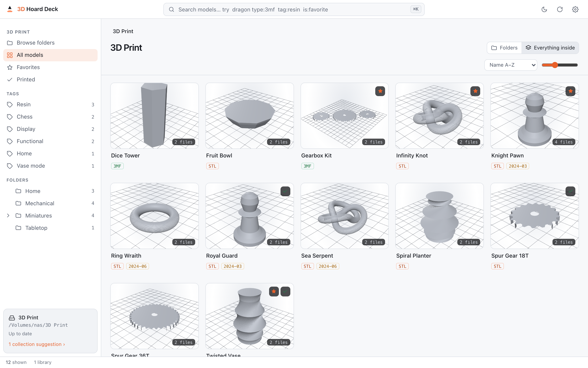
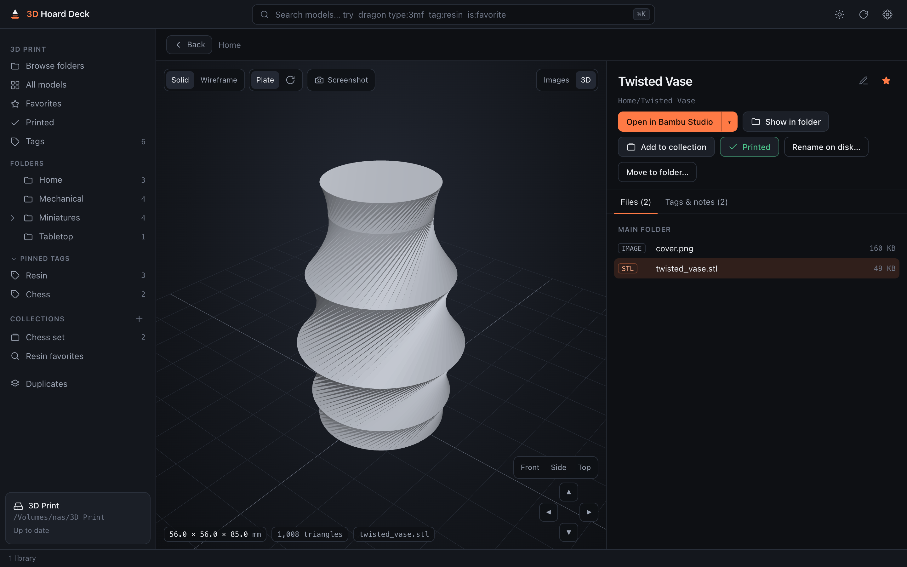
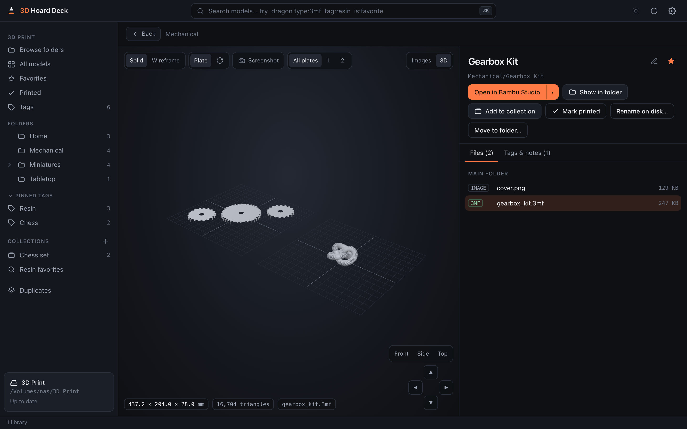
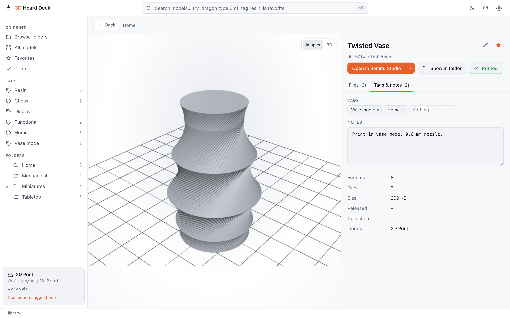
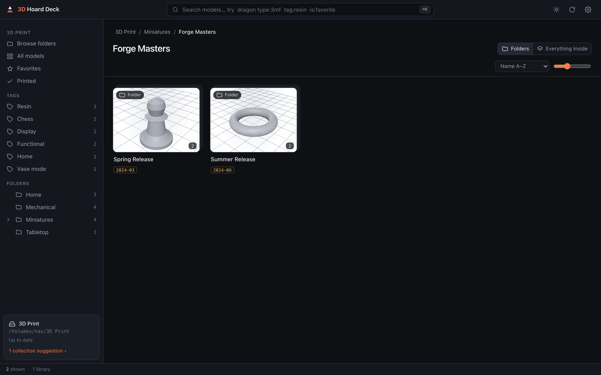
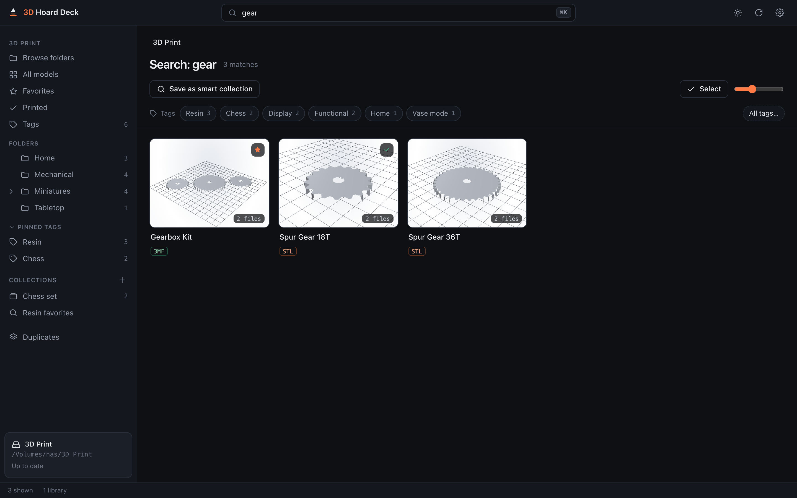
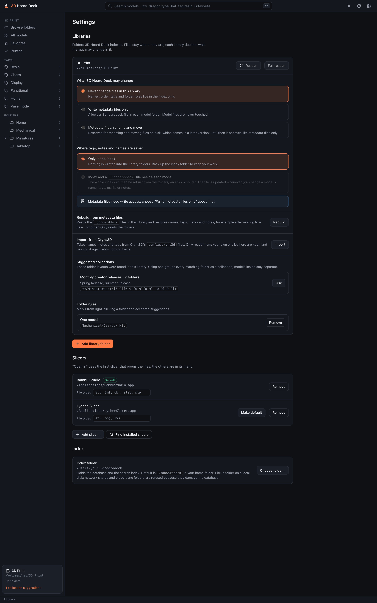

# 3D Hoard Deck

**Your 3D printing library, searchable and good-looking, right where your files already are.**

3D Hoard Deck is a desktop app for macOS, Windows and Linux that turns folders full of STL, 3MF and OBJ
files into a browsable, searchable library with cover images and an interactive 3D preview. It indexes your
folders in place: nothing is moved, copied or uploaded, and the app never writes into your library unless you
allow it.

## What it does

- **Browse your folders as they are.** Breadcrumbs, a folder tree and an "Everything inside" view for deep
  folder structures. Release folders like `2024-03 - Spring Release` show as "Spring Release" with a date badge.
- **One card per printable thing.** A model folder with `Supported`, `Unsupported`, `images` or `75mm`
  subfolders becomes one model, not a pile of folders. You decide where the automatic detection gets it wrong:
  right-click a folder and choose **Treat as one model** or **Treat as collection**.
- **Find anything in milliseconds.** Search forgives typos and partial words (`wolverin` finds Wolverine) and
  can stay inside the current folder.
- **Covers without effort.** Images from the model folder (or an image next to it with the same name) become
  the cover, resized once and cached so the grid stays fast, even over a network share. Folders without a picture
  borrow one from their subfolders, like a movie library, and you can pick a folder's picture yourself.
- **Make your own cover.** Turn a model in the 3D preview until it looks right and press **Screenshot**; the image
  is saved next to the file and becomes the cover of a folder without pictures.
- **Look at the model in 3D.** Rotate, zoom and pan STL, 3MF and OBJ files, with size in millimetres and the
  triangle count. 3MF projects from Bambu Studio and OrcaSlicer show every build plate side by side. Arrow
  buttons and Front, Side and Top views help to turn the model precisely.
- **Open in your slicer.** One click opens the model in Bambu Studio, OrcaSlicer, PrusaSlicer, Lychee or any
  other slicer you add. 3MF projects are preferred, so plates and settings come along.
- **Organize without moving files.** Rename models inside the app, add tags, mark favorites and what you have
  printed, and keep notes. Favorites, Printed and your most used tags are one click away in the sidebar.
- **Collections that set themselves up.** After a scan the app recognizes common pack layouts (Loot Studios
  releases, STLFlix, monthly creator releases and others) and suggests turning them into collections.
- **Look inside ZIP files.** Click a ZIP in the file list to see its contents; STL and OBJ files inside open in
  the 3D viewer without unpacking.
- **Disguised files are no problem.** Binary STLs named `.stl.xxx` and ASCII STLs named `.stl.txt` are
  recognized by their content.
- **Light and dark theme, English and German.** The language follows your system; change it under **Settings ›
  Language**.

| Model page with 3D preview | 3MF project with two build plates |
|---|---|
|  |  |

| Tags, notes and marks | Folders and release dates |
|---|---|
|  |  |

## Getting started

1. **Install the app.** Download the installer for your system from the
   [Releases page](https://github.com/Ragin-LundF/3d-hoard-deck/releases): `.dmg` for macOS (Apple Silicon or
   Intel), `.exe` or `.msi` for Windows, `.AppImage`, `.deb` or `.rpm` for Linux. The builds are not signed with a
   developer certificate yet, so the system asks once: on macOS allow the app under System Settings › Privacy &
   Security › **Open Anyway**; on Windows choose **More info** › **Run anyway**. You can also build it yourself as
   described in [docs/developer.md](docs/developer.md#build-an-installer).
2. **Add your library.** On first start choose **Add library folder** and pick the folder with your models,
   for example a folder on your NAS. The first scan starts right away; large libraries on a network share take
   a few minutes, and you can keep browsing meanwhile.
3. **Browse, search, print.** Click a card to see its files and images, switch to **3D**, and press
   **Open in Bambu Studio** (or your default slicer).

### Search tips

| Type | Finds |
|---|---|
| `dragon` | models whose name or folder path contains "dragon", also with small typos |
| `red dragon` | models matching both words |
| `type:3mf` or `format:stl` | only models with that file type |
| `tag:resin` or `tag:"sci fi"` | only models with that tag |
| `is:favorite`, `is:printed` | only favorites, only printed models |
| `in:"Miniatures/Forge Masters"` | only models inside that folder |

Press <kbd>⌘ K</kbd> (macOS) or <kbd>Ctrl K</kbd> to jump to the search box, <kbd>Esc</kbd> to clear it.

### Folder roles

The app guesses what a "model" is: a folder that contains model files, with variant subfolders merged in. When
a layout is unusual, right-click the folder in the sidebar or grid:

- **Treat as one model**: the folder and all its subfolders become one model (for example a dragon whose base
  sits in a `Base` subfolder).
- **Treat as collection**: every model below the folder stays a separate model but belongs to the collection;
  the collection gets its own card and shows all its models when opened.
- **Detect automatically**: back to the default.

All roles and accepted suggestions are listed under **Settings › Libraries**, where each one can be removed.
Changing a role regroups the library within seconds; the folders are not read again.

## Your files are safe

- **Nothing is written into your library by default.** Every library starts as "Never change files in this
  library"; names, tags, marks and notes then live only in the app's index. Model files are only ever opened
  for reading.
- **Rename and move on disk, with undo.** If you set a library to **Metadata files, rename and move**, the model
  page offers **Rename on disk…** and **Move to folder…**. Names, tags, notes and collections move along, an
  existing file or folder is never overwritten, and **Settings › Recent file changes** undoes any change.
- **Optional metadata files.** Under **Settings › Libraries** you can allow metadata files. Then names, tags,
  marks and notes are also stored in a small `.3dhoarddeck` file beside each model, the folder roles in one at the
  library root, and **Rebuild from metadata files** restores everything from the folders, for example on a new
  computer.
- **All app data lives in one folder**, by default `~/.3dhoarddeck` (`%USERPROFILE%\.3dhoarddeck` on Windows):
  the database, the search index and the cover thumbnails. Delete it to start fresh; your library is not
  affected. Move it under **Settings › Index**. It must be on a local disk: network shares and cloud-sync
  folders (iCloud, Dropbox, OneDrive, Google Drive) damage the database and are refused.
- **Offline is fine.** If your NAS is not mounted, the library stays browsable from the index; nothing is
  deleted.

## Settings at a glance

- **Libraries**: add folders, rescan (a **Full rescan** also catches files that were overwritten in place),
  write access, where metadata is kept, rebuild from metadata files, import from Orynt3D, suggested collections
  and folder rules.
- **Slicers**: the list "Open in" uses. The first entry is the default; the others are in the button's menu.
  **Find installed slicers** detects Bambu Studio, OrcaSlicer, PrusaSlicer and Lychee in their usual places;
  **Add slicer…** adds any other program. Adjust the file types each slicer should open.
- **Index**: where the app keeps its data.

## Questions

**Does it work with my Orynt3D library?** Yes. 3D Hoard Deck never changes Orynt3D's `_orynt3d` folders or
`config.orynt3d` files, so both apps can use the same folders. **Settings › Libraries › Import from Orynt3D**
takes over the names, notes and tags you entered there; it only reads the files and can be run again.

**My NAS is slow. Will scanning hurt it?** The first scan reads every folder once with a few parallel reads.
Later scans only look at folders whose modification time changed, which takes seconds instead of minutes.

**Do I have to rescan after adding files?** No. Shortly after the app starts it picks up what changed while it
was closed, and libraries on a local disk are updated a few seconds after files change. Network shares do not
report changes, so the app looks for new folders every 30 minutes. To see new files right away, open the folder
and press **Scan this folder**: only that folder is read again, which takes seconds even in a big library.

**A model shows up twice or is split in pieces.** Right-click its folder and choose **Treat as one model**.

**The 3D preview says the file is too large.** Very large meshes (hundreds of MB) are not previewed yet; open
them in your slicer instead.

## Contributing

Developer setup, architecture and conventions are in [docs/developer.md](docs/developer.md).
